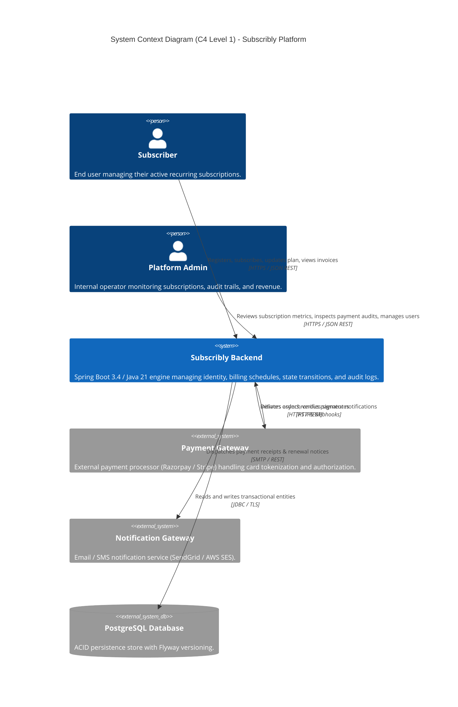
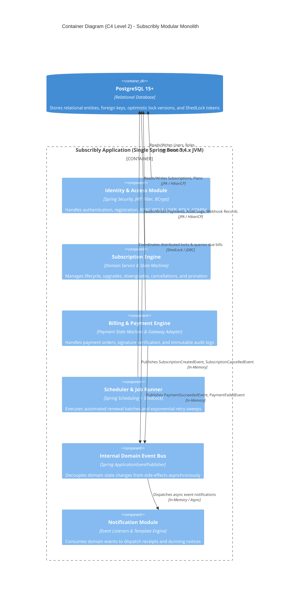
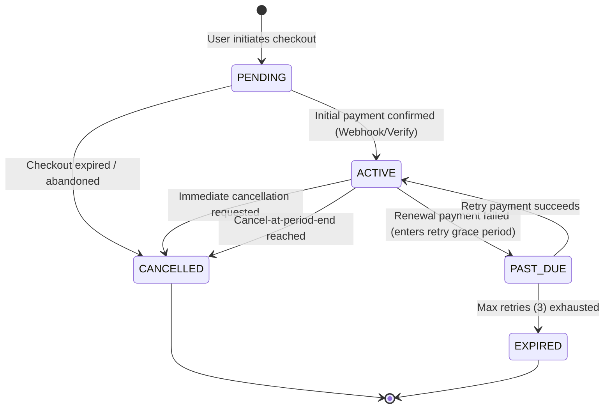
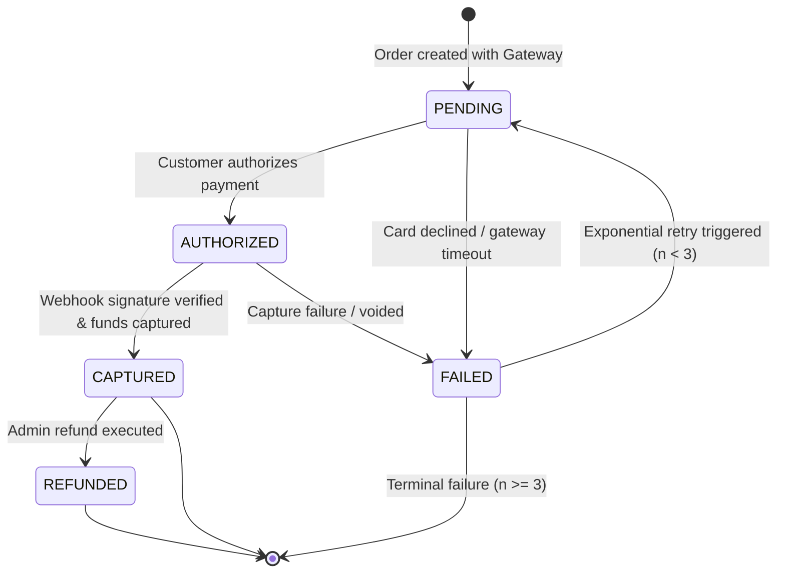

# Subscribly — System Architecture & Design Specification

**Document Version:** 1.0.0  
**Status:** Approved Architectural Baseline  
**Author:** Principal Software Architect & SRE  

---

## 1. System Overview & Context (C4 Level 1)

Subscribly is an enterprise-grade subscription management and recurring billing platform. It handles user identity, plan definitions, subscription lifecycles, automated renewals, payment gateway integration, and webhook idempotency.



---

## 2. Architecture Comparison: Microservices vs Modular Monolith

### 2.1 The Uncommitted Microservices State (Audit Assessment)

The local working tree contains an incomplete decomposition into 8 microservice directories (`api-gateway`, `discovery-server`, `config-server`, `user-service`, `subscription-service`, `payment-service`, `notification-service`, `common-lib`). 

#### Operational & Engineering Deficiencies:
1. **Resource Hunger:** Running 8 separate JVMs + Apache Kafka + Zookeeper + Redis + PostgreSQL requires at minimum **3.5 GB to 5.0 GB of RAM**. It cannot run on free cloud tiers (Render, Railway, Fly.io, Neon).
2. **Cascading Distributed Failures:** `subscription-service` calls `user-service` synchronously via Spring Cloud OpenFeign; `payment-service` calls both `subscription-service` and `user-service`. If any service experiences a network timeout or restarts, downstream transactions fail with unhandled `FeignException` errors.
3. **Loss of Atomic Transactions:** Creating a subscription and its initial invoice requires distributed coordination. Without complex distributed sagas or 2PC, network partitions create orphaned subscriptions and unrecorded charges.
4. **Premature Complexity:** Decomposing a system with zero automated tests into microservices introduces network latency, serialization overhead, and distributed tracing complexity before core business rules (proration, idempotency, retry backoff) are even verified.

---

### 2.2 Target Architecture: High-Cohesion Modular Monolith

To achieve maximum reliability, transactional safety, and zero-budget public deployability, Subscribly adopts a **Domain-Driven Modular Monolith**.



#### Why This Wins in Technical Interviews:
- **Zero-Budget Cloud Deployable:** A single JVM container with optimized memory parameters (`-XX:MaxRAMPercentage=75.0`) fits within a 512 MB Render/Railway free instance with Neon serverless Postgres.
- **Transactional Consistency:** Database operations across subscription creation and payment audit trails execute within an atomic PostgreSQL transaction (`@Transactional`), completely eliminating distributed split-brain scenarios.
- **Clean Evolutionary Path:** Domain modules interact exclusively through documented service interfaces and DTOs. If horizontal scaling is ever required, any module can be separated into an independent service with zero code rewrite.

---

## 3. Component Responsibilities & Domain Boundaries

```
com.subscribly/
├── common/                  # Cross-cutting utilities, base entities, error responses
│   ├── entity/              # BaseEntity (createdAt, updatedAt, version)
│   ├── exception/           # Business exceptions & RFC 7807 GlobalExceptionHandler
│   └── lock/                # Distributed locking abstractions
├── user/                    # Identity & Access Management
│   ├── entity/              # User, Role, Status
│   ├── repository/          # UserRepository, RoleRepository
│   ├── service/             # UserService, AuthService
│   ├── controller/          # AuthController, UserController, AdminUserController
│   └── security/            # SecurityConfig, JwtAuthFilter, JwtUtil
├── subscription/            # Subscription Domain
│   ├── entity/              # Subscription, Plan, BillingCycle, SubscriptionStatus
│   ├── statemachine/        # SubscriptionStateMachine (validates transitions)
│   ├── service/             # SubscriptionService, ProrationService
│   ├── controller/          # SubscriptionController, AdminSubscriptionController
│   └── event/               # SubscriptionCreatedEvent, SubscriptionCancelledEvent
├── payment/                 # Payment & Billing Engine
│   ├── entity/              # Payment, PaymentStatus, PaymentAuditLog, WebhookRecord
│   ├── statemachine/        # PaymentStateMachine
│   ├── gateway/             # PaymentGatewayClient (MockGateway, RazorpayGateway)
│   ├── scheduler/           # RenewalScheduler, PaymentRetryScheduler
│   ├── service/             # PaymentService, WebhookService, PaymentAuditService
│   └── controller/          # PaymentController, WebhookController
└── notification/            # Asynchronous Notifications
    ├── listener/            # Domain event listeners
    └── service/             # EmailService, NotificationService
```

---

## 4. State Machines & Lifecycle Engines

### 4.1 Subscription State Machine



### 4.2 Payment State Machine & Audit Trail



---

## 5. Concurrency & Idempotency Design

### 5.1 Webhook Idempotency Guard
Payment webhooks are inherently at-least-once delivery systems. To prevent duplicate payment captures or double-crediting subscriptions:
1. Every incoming webhook payload contains a provider event ID (`event_id`).
2. An atomic `INSERT INTO webhook_events (event_id, received_at, status)` is executed with a unique constraint on `event_id`.
3. If an `UniqueConstraintViolationException` occurs, the webhook handler immediately acknowledges HTTP 200 OK without processing the body a second time.

### 5.2 Renewal Job Distributed Locking (ShedLock)
To guarantee that scheduled billing renewals cannot run concurrently across multiple instances or during long-running batch iterations:
- Scheduled methods are annotated with `@SchedulerLock(name = "SubscriptionRenewal", lockAtMostFor = "10m", lockAtLeastFor = "1m")`.
- PostgreSQL maintains an atomic row lock in the `shedlock` table, preventing duplicate invoice generation and race conditions.

### 5.3 Optimistic Locking on Entities
Every entity extends `BaseEntity` with:
```java
@Version
private Long version;
```
Concurrent updates (e.g. an admin cancelling a subscription at the exact moment a background renewal job processes) will trigger `OptimisticLockingFailureException`, preventing lost updates and silent state overwrites.

---

## 6. Security & Network Architecture

1. **Stateless Authentication:** JSON Web Tokens signed with HMAC-SHA256 (`jjwt 0.12.x`), containing subject ID, email, and explicit granted authorities (`ROLE_USER`, `ROLE_ADMIN`).
2. **Authority Enforcement:**
   - Public: `/api/v1/auth/**`, `/api/v1/webhooks/**`, `/actuator/health`, `/swagger-ui/**`.
   - Subscriber: `/api/v1/subscriptions/my`, `/api/v1/payments/checkout`.
   - Admin Only: `/api/v1/admin/**`, `/actuator/**` (except health).
3. **Defense-in-Depth:**
   - Strict CORS policy restricting origins to trusted frontend domains.
   - Secret key injection via environment variables (`JWT_SECRET`, `DB_PASSWORD`, `RAZORPAY_SECRET`).
   - Sensitive actuator endpoints (`env`, `beans`, `threaddump`) require authenticated admin credentials.
