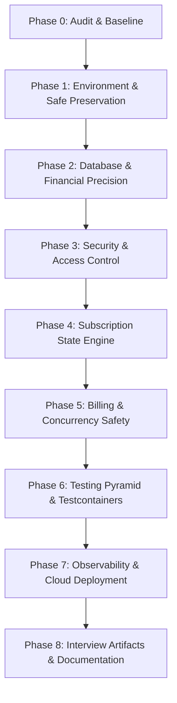

# Subscribly — Engineering Implementation Plan

**Author:** Principal Backend Engineer / Architect  
**Project Status:** Phase Zero Completed (Audit & Baseline Established)  
**Target Environment:** Java 21 LTS, Spring Boot 3.4.x, PostgreSQL 15+, Flyway, Docker  

---

## 1. Executive Summary & Strategy

This implementation plan outlines the systematic transformation of Subscribly into an enterprise-grade, interview-ready subscription and billing engine. 

### Core Strategy: Pragmatic Modular Monolith First
The audit revealed an uncommitted, incomplete microservices decomposition with 7+ services requiring Kafka, Eureka, and Redis. Running this stack requires >3 GB RAM and cannot be hosted on free-tier cloud environments (Render, Railway, Neon). 
- **Preservation:** The uncommitted microservices work will be safely preserved in a dedicated branch (`archive/microservices-wip`).
- **Target Implementation:** The core application will be hardened as a **high-cohesion, loosely coupled Modular Monolith**. This ensures zero-budget cloud deployability, transactional integrity across billing boundaries, zero network-hop latency, and bulletproof defensibility in SDE-1/2 interviews.

---

## 2. Phase Breakdown & Execution Roadmap



---

### Phase 0: Audit & Baseline Verification (STATUS: COMPLETED ✅)

| Task ID | Description | Acceptance Criteria | Priority | Status |
|---|---|---|---|---|
| `TASK-001` | Inspect Git history, branches, working tree modifications, and deleted files | Full accounting of 32 deleted files and 15 untracked directories documented in `PROJECT_AUDIT.md`. | P0 | ✅ DONE |
| `TASK-002` | Diagnose toolchain discrepancy (JDK 25 runtime vs JDK 21 POM target) | Root cause documented: Lombok 1.18.x incompatible with JDK 25 javac internal APIs. Clean build verified under JDK 21. | P0 | ✅ DONE |
| `TASK-003` | Execute build and test suite baseline under compatible JDK 21 | Clean reactor compile (`10/10` modules in 2.5s) and `SubscriblyApplicationTests` pass recorded. | P0 | ✅ DONE |
| `TASK-004` | Audit security, domain models, business logic, and deployment constraints | Critical vulnerabilities (disabled security, hardcoded secrets, `Double` currency) documented. | P0 | ✅ DONE |
| `TASK-005` | Author architectural documentation and ADRs | `PROJECT_AUDIT.md`, `IMPLEMENTATION_PLAN.md`, `ARCHITECTURE.md`, `TEST_STRATEGY.md`, and ADR-001 created. | P0 | ✅ DONE |

---

### Phase 1: Environment & Repository Hygiene (Safe Branching & Baseline)

| Task ID | Description | Acceptance Criteria | Priority | Status |
|---|---|---|---|---|
| `TASK-101` | Safely preserve uncommitted microservices work | Create dedicated branch `archive/microservices-wip`, commit all untracked microservice modules without data loss. | P0 | ⏳ PENDING |
| `TASK-102` | Establish clean, working baseline on `main` | Clean working tree compiling with Maven Wrapper under JDK 21; `.mvn/jvm.config` configured. | P0 | ⏳ PENDING |
| `TASK-103` | Configure GitHub Actions CI workflow | Automated CI pipeline (`.github/workflows/ci.yml`) testing on JDK 21 on every pull request and push to `main`. | P0 | ⏳ PENDING |
| `TASK-104` | Configure Maven Enforcer Plugin | Enforce minimum Java version (21) and Maven version (3.9+) during build lifecycle. | P1 | ⏳ PENDING |

---

### Phase 2: Database Migration & Financial Precision (Zero `ddl-auto`)

| Task ID | Description | Acceptance Criteria | Priority | Status |
|---|---|---|---|---|
| `TASK-201` | Introduce Flyway database migrations | Disable `hibernate.ddl-auto: update` (`ddl-auto: validate`); create baseline migration script `V1__init_schema.sql`. | P0 | ⏳ PENDING |
| `TASK-202` | Convert monetary values to `BigDecimal` | Change all `Double` prices and payment amounts in entities, DTOs, and queries to `BigDecimal` with `DECIMAL(12,2)`. | P0 | ⏳ PENDING |
| `TASK-203` | Fix reserved keywords and table mappings | Rename table for `User` entity to `users` or escape `"user"` properly in PostgreSQL. | P0 | ⏳ PENDING |
| `TASK-204` | Add relational constraints and indexes | Add foreign keys with index coverage, non-null constraints, and unique index on `(user_id, plan_id, status)` for active subscriptions. | P1 | ⏳ PENDING |
| `TASK-205` | Implement Optimistic Locking | Add `@Version private Long version` to `Subscription` and `Payment` entities to prevent lost updates during concurrent edits. | P1 | ⏳ PENDING |

---

### Phase 3: Production Security, Authentication & Access Control

| Task ID | Description | Acceptance Criteria | Priority | Status |
|---|---|---|---|---|
| `TASK-301` | Re-enable full Spring Security filter chain | Remove all `@EnableAutoConfiguration(exclude = ...)` security exclusions; ensure all public/private endpoints are explicitly mapped. | P0 | ⏳ PENDING |
| `TASK-302` | Externalize sensitive configuration | Remove hardcoded JWT secret, database passwords, and API keys. Use environment variables with safe dev fallbacks. | P0 | ⏳ PENDING |
| `TASK-303` | Fix JWT claim processing & authorities | Ensure JWT parser extracts user roles (`ROLE_USER`, `ROLE_ADMIN`) and sets `GrantedAuthority` list on `Authentication` object. | P0 | ⏳ PENDING |
| `TASK-304` | Secure internal and administrative endpoints | Enforce `@PreAuthorize("hasRole('ADMIN')")` on all admin endpoints (`/api/v1/admin/**`); close open `/internal/**` endpoints. | P0 | ⏳ PENDING |
| `TASK-305` | Implement Rate Limiting | Add bucket-based rate limiting on `/api/v1/auth/login`, `/api/v1/auth/register`, and `/api/v1/payments/create-order`. | P1 | ⏳ PENDING |
| `TASK-306` | Implement Global Exception Handling & Error DTOs | Standardized `ProblemDetails` / RFC 7807 error responses for 400, 401, 403, 404, 409, and 500 without leaking stack traces. | P1 | ⏳ PENDING |

---

### Phase 4: Core Domain Engine — Subscription Lifecycle

| Task ID | Description | Acceptance Criteria | Priority | Status |
|---|---|---|---|---|
| `TASK-401` | Enforce Subscription State Machine | Strict transitions: `PENDING` → `ACTIVE` → `PAST_DUE` → `CANCELLED`/`EXPIRED`. Disallow illegal state jumps. | P0 | ⏳ PENDING |
| `TASK-402` | Implement dual-mode cancellation | Support immediate cancellation (`cancelImmediately=true`) and cancel-at-period-end (`cancelImmediately=false`). | P1 | ⏳ PENDING |
| `TASK-403` | Implement billing cycle adjustments & proration | Support `MONTHLY` vs `YEARLY` cycle changes with calculated credit/charge adjustments. | P1 | ⏳ PENDING |
| `TASK-404` | Implement plan upgrade / downgrade flows | Transition active subscription to new plan with calculated pro-rated fee and billing period update. | P2 | ⏳ PENDING |

---

### Phase 5: Billing Engine, Payment State Machine & Concurrency Safety

| Task ID | Description | Acceptance Criteria | Priority | Status |
|---|---|---|---|---|
| `TASK-501` | Payment State Machine & Audit Trail | Formal state transitions (`PENDING` → `AUTHORIZED` → `CAPTURED` / `FAILED`). Append-only `PaymentAuditTrail` logging every transition. | P0 | ⏳ PENDING |
| `TASK-502` | Idempotent payment & webhook ingestion | Unique `idempotency_key` header on payment creation; unique constraint on `webhook_events.event_id` with atomic DB insert. | P0 | ⏳ PENDING |
| `TASK-503` | Automated renewal scheduler with distributed locking | `@Scheduled` renewal job protected by ShedLock to ensure single-instance execution in clustered/scaled deployments. | P1 | ⏳ PENDING |
| `TASK-504` | Resilient exponential retry processor | Failed payments scheduled for retry: 15m, 30m, 60m up to `MAX_RETRIES = 3`. Subscriptions marked `PAST_DUE` after final failure. | P1 | ⏳ PENDING |
| `TASK-505` | Gateway abstraction & Webhook verification | Interface `PaymentGatewayClient` implemented by `MockPaymentGateway` and `RazorpayGateway`; HMAC-SHA256 signature verification. | P1 | ⏳ PENDING |

---

### Phase 6: Comprehensive Testing Pyramid & Testcontainers

| Task ID | Description | Acceptance Criteria | Priority | Status |
|---|---|---|---|---|
| `TASK-601` | Unit test suite (domain logic & state machines) | Comprehensive unit tests for state machines, proration formulas, and JWT utilities with >85% branch coverage. | P0 | ⏳ PENDING |
| `TASK-602` | Controller slice tests (`@WebMvcTest`) | MockMvc tests for all REST endpoints validating authentication, validation annotations (`@Valid`), and HTTP status codes. | P1 | ⏳ PENDING |
| `TASK-603` | Integration tests with Testcontainers | SpringBootTest with real PostgreSQL container validating Flyway migrations, JPA queries, and transactional rollbacks. | P0 | ⏳ PENDING |
| `TASK-604` | Concurrency and race condition testing | Multi-threaded executor tests simulating concurrent duplicate webhooks and overlapping renewal jobs verifying zero duplicate charges. | P0 | ⏳ PENDING |
| `TASK-605` | Security and RBAC test suite | Tests verifying that unauthenticated users, regular users, and admins receive exact 401/403 responses across all protected routes. | P1 | ⏳ PENDING |

---

### Phase 7: Observability, SRE & Production Deployment

| Task ID | Description | Acceptance Criteria | Priority | Status |
|---|---|---|---|---|
| `TASK-701` | Actuator, Micrometer & Prometheus metrics | Configure custom business metrics: `subscriptions.active`, `payments.success.count`, `payments.failure.count`, `renewals.processed`. | P1 | ⏳ PENDING |
| `TASK-702` | Structured JSON logging with Correlation ID | Logback configured for JSON format in prod; MDC filter extracting or injecting `X-Request-Id` across all requests. | P1 | ⏳ PENDING |
| `TASK-703` | Multi-stage Docker containerization | Optimized Dockerfile using Eclipse Temurin 21 JRE Alpine image with non-root user and layer caching (<200MB image). | P0 | ⏳ PENDING |
| `TASK-704` | Zero-budget cloud deployment setup | Complete deployment manifests / Docker Compose for Render/Railway + Neon PostgreSQL with automated health check probes. | P0 | ⏳ PENDING |

---

### Phase 8: Technical Interview Artifacts & Documentation

| Task ID | Description | Acceptance Criteria | Priority | Status |
|---|---|---|---|---|
| `TASK-801` | Interactive OpenAPI / Swagger Documentation | Complete Swagger UI with request/response schemas, authentication button, and error examples at `/swagger-ui.html`. | P1 | ⏳ PENDING |
| `TASK-802` | Production README & System Architecture Guide | System overview, live demo link, architecture diagram, design decisions, and local setup guide. | P0 | ⏳ PENDING |
| `TASK-803` | SDE-1 / SDE-2 Interview Defense Playbook | Detailed guide explaining concurrency design, distributed locks vs DB transactions, billing failure modes, and interview questions. | P0 | ⏳ PENDING |

---

## 3. Verification Commands Summary

```bash
# Compile and package entire application
.\mvnw.cmd clean package -DskipTests

# Run full automated test suite (Unit + Integration)
.\mvnw.cmd test

# Run integration tests against real PostgreSQL Testcontainer
.\mvnw.cmd verify -P integration-test

# Build Docker image
docker build -t subscribly:latest .
```
