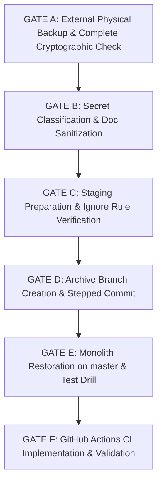

# Subscribly — Phase 1 Execution & Disaster Recovery Plan

**Document Version:** 5.0.0 (Pre-Execution Audit & Rigorous Verification Edition)  
**Author:** Principal Software Architect & DevOps Lead  
**Document Status:** Ready for User Review & Approval (Execution Gated)  
**Target Baseline:** Java 21 LTS, Maven Wrapper, PostgreSQL 15, GitHub Actions CI  
**Repository State:** Current branch `microservices-v2`, Target baseline commit `f1353e1` on `master`  
**Prerequisites:** Phase Zero Audit Completed; Critical Review Documented in `CRITICAL_REVIEW.md`  
**Execution Status:** NOT EXECUTED (Read-Only Planning Phase)  

---

## 1. Executive Safety Principles & Non-Negotiable Rules

Phase 1 is strictly limited to **repository preservation, environment hygiene, toolchain reproducibility, and CI foundation**. 

### Hard Constraints:
1. **Zero application code changes:** No entity, controller, service, database schema, or business logic code will be modified.
2. **Zero unapproved POM modifications:** All POM changes are specified in this plan and gated until approved.
3. **Zero data loss:** Every tracked file, modified file, deleted file, and untracked microservices module will be 100% preserved.
4. **No branch switching prior to physical backup:** No destructive Git commands (`git clean`, `git reset --hard`) will ever be executed.
5. **No unapproved Git pushes:** No code or branches will be pushed to remote GitHub repositories without explicit instruction.
6. **Independent Gating:** No gate proceeds automatically. Each gate requires explicit verification and user confirmation before moving to the next. Gate A must **never** trigger Gate B automatically.
7. **Backups Are Immutable Safety Nets:** A backup must **never be deleted** as part of an operational rollback. Rollback reverts repository state changes; backup retirement is a distinct, post-verification administrative action.

---

## 2. Production Baseline & Commit Verification

### 2.1 Commit Identification
Running `git log --stat` across repository history reveals:
- **`f1353e1` ("Add method to find payments to process with query", committed 2026-07-09)** is the exact commit containing the complete, working original monolith:
  - Tracked single-module [`pom.xml`](file:///d:/Projects/Subscribly/subscribly/pom.xml) declaring Spring Boot dependencies.
  - Complete [`src/`](file:///d:/Projects/Subscribly/subscribly/src) tree (32 source files: entities, repositories, services, controllers, DTOs, scheduler, and `SubscriblyApplicationTests`).
- Both `master` and `microservices-v2` point to this identical commit:
  ```text
  git rev-parse master            -> f1353e1e85f87a14b924f603b11fe6eb96cdbbf4
  git rev-parse microservices-v2  -> f1353e1e85f87a14b924f603b11fe6eb96cdbbf4
  ```

### 2.2 The Branch Switching Fallacy
Because `master` and `microservices-v2` point to the exact same commit, executing `git checkout master` merely updates the `HEAD` pointer. **It does not touch or restore the working tree.** The 32 deleted files, 1 modified `pom.xml`, and 15 untracked directories remain in their dirty uncommitted state. Tracked files must be explicitly restored to `f1353e1` *after* creating an external physical backup and committing the uncommitted microservices snapshot to an archive branch.

---

## 3. Independent Verification Gates (Execution Roadmap)



---

### GATE A: Backup and Complete Cryptographic Verification (Failsafe Outside Git)
*Purpose:* Provide an independent, non-Git verifiable external copy with dual source-manifest drift detection before executing any Git operations.

- **Shell:** Windows PowerShell (standard console or Administrator).
- **Operation:** Enterprise recursive mirror backup using `robocopy` accompanied by **dual source-manifest verification** (pre-copy and post-verification source manifests), full cryptographic source-versus-backup SHA-256 verification of every regular file (including hidden files, untracked files, ignored files, and `.git`), and bidirectional directory inventory verification (including empty subdirectories).
- **Mandatory Quiescence Requirement:**
  1. The repository must remain strictly quiescent (zero write operations from any process) throughout the entire execution window (from pre-copy manifest capture through Robocopy copying and post-verification manifest capture).
  2. **Operational Enforcement:** The operator must verify and enforce before execution:
     - All IDE background language servers, compilation daemons, and file indexing (e.g., VS Code Java Language Server, IntelliJ indexing, Vite/Webpack file watchers) are stopped.
     - No Maven (`mvn`, `mvnw`), Gradle, or test runner processes are active in the background.
     - No Docker containers or background services have write-mounted volumes to `subscribly`.
     - No concurrent terminal sessions or scripts are modifying files or Git state.
  3. **Stopping Condition:** If quiescence cannot be guaranteed, execution must not proceed. If source drift is detected between pre-copy and post-verification manifests (`$srcDriftCount -gt 0`), the snapshot is rejected and execution stops immediately.
- **Technical Limitation (Transient State Modifications):**
  Dual-manifest observation proves that all observed files, directories, sizes, and hashes remained identical between observation points $T_{pre}$ and $T_{post}$. However, dual-manifest comparison cannot prove the absence of transient modifications that occurred strictly *during* the file copying window and were reverted before $T_{post}$, nor does it provide atomic point-in-time transactional snapshots in the absence of an operating-system-level volume snapshot mechanism (such as Windows Volume Shadow Copy Service / VSS). Therefore, operational quiescence is an indispensable procedural prerequisite and cannot be replaced by post-hoc algorithmic checks alone.
- **Prerequisites:**
  1. **Executable Disk Space Guard:** Minimum 2 GB free disk space on drive `D:`. Verified programmatically prior to creating any parent directories, log files, or manifest artifacts; failure to query or `< 2 GB` triggers immediate fatal abort.
  2. Backup destination directory `d:\Projects\Subscribly_backups\subscribly_backup_phase0` must **NOT** already exist.
  3. **Failed-Attempt Evidence Preservation:** Prior attempt logs (specifically `d:\Projects\Subscribly_backups\backup_phase0.log`) are permanently preserved and must never be deleted or overwritten. Each authorized attempt uses a distinct, collision-resistant unique log file and manifest path.
- **Execution Sequence & Session Scope Architecture:**
  - **Single-Attempt Binding & Unique RunId:** Each authorized backup attempt generates a cryptographically distinct, timestamped attempt identifier (`$runId`) formatted as `yyyyMMdd_HHmmssfff_<guid8>`. This `RunId` is immutably encoded into:
    1. The backup log filename: `d:\Projects\Subscribly_backups\backup_phase0_<RunId>.log`
    2. The pre-copy source manifest filename: `d:\Projects\Subscribly_backups\manifest_source_pre_<RunId>.json`
    3. The pre-copy source manifest schema: `RunId` field
    4. The pre-copy source manifest schema: `RootPath` (absolute source root) and `BackupLogPath` (exact expected log path)
  - **Intended Execution Mode (Same Session):** Execute Command Block 1 (Pre-Manifest & Copy) followed immediately by Command Block 2 (Verification Script) within the **same continuous PowerShell session**. All session-scoped variables (`$backupLog`, `$srcManifestPrePath`, `$runId`) pass automatically into the verification step.
  - **Supported Separate Session Mode (State Reconstruction):** If verification is executed in a separate or fresh PowerShell session, the operator **must explicitly specify the exact bound paths** (`$backupLog` and `$srcManifestPrePath`) output by the authorized attempt.
  - **Mandatory Attempt Association Checks:** During verification, the script strictly validates that:
    1. The filename-encoded `RunId` in `$backupLog` and `$srcManifestPrePath` match the required pattern and are identical to each other.
    2. The manifest's internal `RunId` matches the filename-encoded `RunId`.
    3. The manifest's recorded `RootPath` matches the configured source root.
    4. The manifest's recorded `BackupLogPath` matches the explicitly supplied `$backupLog`.
    5. All schema fields exist with valid types, non-negative counters, positive file counts, and matching array/dictionary counts.
  - **Strict Prohibition of Automatic Discovery:** Automatic selection of the "latest" log or manifest (e.g., via directory sort or wildcards) is strictly prohibited. Missing, mismatched, malformed, or inconsistent artifacts trigger an immediate fatal abort.
  - **Full State Persistence in Pre-Manifest:** To ensure verification is completely self-contained and verifiable across sessions, the pre-copy manifest schema explicitly persists all enumeration metrics: `RunId`, `TimestampUtc`, `RootPath`, `BackupLogPath`, `DirCount`, `FileCount`, `UnreadableFilesCount`, `DuplicateFilesCount`, `DuplicateDirsCount`, `ReparsePoints`, `Dirs`, and `Files`. The verification script validates this schema on deserialization, reconstructing counters directly from the persisted artifact. If any schema field is missing or invalid, it fails closed.
- **Fail-Closed Safety Guard:** If the destination directory already exists, execution must **STOP IMMEDIATELY** to prevent stale files from contaminating the snapshot.
- **Log and Manifest Isolation:** All logs and manifest files are written to dedicated, collision-resistant files in `d:\Projects\Subscribly_backups\`, residing completely outside the repository and modifying zero source files.

#### Exact Commands (PowerShell):
```powershell
$ErrorActionPreference = 'Stop'
$srcRoot = "d:\Projects\Subscribly\subscribly"
$dstRoot = "d:\Projects\Subscribly_backups\subscribly_backup_phase0"

# Guard 0: Executable preflight check for available free space on drive D: (minimum 2 GB required)
try {
    $driveD = Get-PSDrive -Name 'D' -ErrorAction Stop
    if ($null -eq $driveD.Free -or $driveD.Free -lt 2GB) {
        $freeGB = if ($null -ne $driveD.Free) { [math]::Round($driveD.Free / 1GB, 2) } else { 0 }
        throw "Insufficient free disk space on drive D: ($freeGB GB available). Minimum 2 GB required."
    }
} catch {
    throw "[FATAL] Free disk space preflight check failed on drive D: $_"
}

# Guard 1: Fail closed if destination already exists
if (Test-Path -LiteralPath $dstRoot) {
    throw "[FATAL] Backup destination directory already exists: $dstRoot. Aborting to prevent stale file contamination."
}

# Guard 2: Generate collision-resistant unique RunId and manifest/log paths, verifying neither exists
$runId = (Get-Date).ToString("yyyyMMdd_HHmmssfff") + "_" + [System.Guid]::NewGuid().ToString("N").Substring(0, 8)
$backupLog = "d:\Projects\Subscribly_backups\backup_phase0_$runId.log"
$srcManifestPrePath = "d:\Projects\Subscribly_backups\manifest_source_pre_$runId.json"

if (Test-Path -LiteralPath $backupLog) {
    throw "[FATAL] Generated backup log path already exists: $backupLog. Halting to prevent overwriting existing logs."
}
if (Test-Path -LiteralPath $srcManifestPrePath) {
    throw "[FATAL] Generated source pre-manifest path already exists: $srcManifestPrePath. Halting to prevent overwriting."
}

# 1. Create target backup parent directory
New-Item -ItemType Directory -Force -Path "d:\Projects\Subscribly_backups" | Out-Null

# 2. Capture Pre-Copy Source Manifest (T_pre) under Quiescence
Write-Host "Capturing Pre-Copy Source Manifest ($srcRoot)..." -ForegroundColor Cyan
$preFiles = @{}
$preDirs = @{}
$preReparse = @()
$duplicatePreFiles = 0
$duplicatePreDirs = 0
$unreadablePreFiles = 0

try {
    Get-ChildItem -LiteralPath $srcRoot -Recurse -Force | ForEach-Object {
        $rel = $_.FullName.Substring($srcRoot.Length).TrimStart('\', '/')
        if ($_.Attributes -band [System.IO.FileAttributes]::ReparsePoint) {
            $preReparse += $_.FullName
        } elseif ($_.PSIsContainer) {
            if ($preDirs.ContainsKey($rel)) { $duplicatePreDirs++ }
            $preDirs[$rel] = $true
        } else {
            if ($preFiles.ContainsKey($rel)) { $duplicatePreFiles++ }
            try {
                $h = (Get-FileHash -LiteralPath $_.FullName -Algorithm SHA256 -ErrorAction Stop).Hash
                $preFiles[$rel] = @{ Length = $_.Length; Hash = $h }
            } catch {
                Write-Host "[UNREADABLE SOURCE FILE PRE-COPY] $rel : $_" -ForegroundColor Yellow
                $unreadablePreFiles++
            }
        }
    }
} catch {
    throw "[FATAL] Source enumeration failed during pre-copy manifest capture: $_"
}

if ($unreadablePreFiles -gt 0 -or $duplicatePreFiles -gt 0 -or $duplicatePreDirs -gt 0) {
    throw "[FATAL] Pre-copy source manifest capture detected unreadable files ($unreadablePreFiles) or duplicate entries. Aborting backup."
}

# Persist pre-copy manifest with complete schema and attempt binding for audit and verification
@{
    RunId = $runId
    TimestampUtc = (Get-Date).ToUniversalTime().ToString("yyyy-MM-ddTHH:mm:ssZ")
    RootPath = $srcRoot
    BackupLogPath = $backupLog
    DirCount = $preDirs.Count
    FileCount = $preFiles.Count
    UnreadableFilesCount = $unreadablePreFiles
    DuplicateFilesCount = $duplicatePreFiles
    DuplicateDirsCount = $duplicatePreDirs
    ReparsePoints = @($preReparse)
    Dirs = @($preDirs.Keys)
    Files = $preFiles
} | ConvertTo-Json -Depth 5 | Set-Content -LiteralPath $srcManifestPrePath -Encoding UTF8

Write-Host "Pre-copy source manifest captured [RunId: $runId] ($($preFiles.Count) files, $($preDirs.Count) dirs) -> $srcManifestPrePath" -ForegroundColor Green

# 3. Execute robocopy with full subdirectories (/E), directory timestamps (/DCOPY:DAT), 1 retry (/R:1), exclude junctions (/XJ)
# NOTE: Standard copying uses user NTFS permissions. Do not assume source files are readable; any read/write permission failures will be caught by Robocopy and exit code checks.
robocopy $srcRoot $dstRoot /E /DCOPY:DAT /R:1 /W:1 /XJ /TEE /LOG:$backupLog

# Note: Robocopy exit codes 0-7 indicate success; >= 8 indicates error
$robocopyExit = $LASTEXITCODE
if ($robocopyExit -ge 8) {
    throw "[FATAL] Robocopy encountered fatal errors. Exit code: $robocopyExit. Check $backupLog"
}
```

#### Exact Verification Script (PowerShell):
```powershell
$ErrorActionPreference = 'Stop'
$srcRoot = "d:\Projects\Subscribly\subscribly"
$dstRoot = "d:\Projects\Subscribly_backups\subscribly_backup_phase0"

# Exact Log & Manifest Binding: Must be explicitly bound to the authorized attempt's artifacts.
# INTENDED EXECUTION: Run in the same session as Block 1 ($backupLog and $srcManifestPrePath already populated).
# SEPARATE SESSION SUPPORT: If run in a fresh session, the operator MUST explicitly initialize both variables with
# the exact paths from the authorized attempt before running this script. Automatic discovery of 'latest' is forbidden.
# Example:
#   $backupLog = "d:\Projects\Subscribly_backups\backup_phase0_<RunId>.log"
#   $srcManifestPrePath = "d:\Projects\Subscribly_backups\manifest_source_pre_<RunId>.json"

if (-not $backupLog -or -not (Test-Path -LiteralPath $backupLog)) {
    throw "[FATAL] Bound backup log `$backupLog is missing, undefined, or unreadable: '$backupLog'. Explicit binding required."
}
if (-not $srcManifestPrePath -or -not (Test-Path -LiteralPath $srcManifestPrePath)) {
    throw "[FATAL] Bound pre-copy source manifest `$srcManifestPrePath is missing, undefined, or unreadable: '$srcManifestPrePath'. Explicit binding required."
}

# 0. Validate artifact filename syntax and extract encoded RunId
$logLeaf = Split-Path -Leaf $backupLog
$manifestLeaf = Split-Path -Leaf $srcManifestPrePath

if ($logLeaf -notmatch '^backup_phase0_([0-9]{8}_[0-9]{9}_[0-9a-fA-F]{8})\.log$') {
    throw "[FATAL] Backup log filename '$logLeaf' does not conform to expected attempt pattern 'backup_phase0_<RunId>.log'"
}
$logEncodedRunId = $matches[1]

if ($manifestLeaf -notmatch '^manifest_source_pre_([0-9]{8}_[0-9]{9}_[0-9a-fA-F]{8})\.json$') {
    throw "[FATAL] Pre-copy manifest filename '$manifestLeaf' does not conform to expected attempt pattern 'manifest_source_pre_<RunId>.json'"
}
$manifestEncodedRunId = $matches[1]

if ($logEncodedRunId -ne $manifestEncodedRunId) {
    throw "[FATAL] Attempt mismatch between log and manifest filenames: Log RunId '$logEncodedRunId' != Manifest RunId '$manifestEncodedRunId'"
}
$expectedRunId = $manifestEncodedRunId

Write-Host "================ STARTING CRYPTOGRAPHIC VERIFICATION ================" -ForegroundColor Cyan
Write-Host "Attempt RunId: $expectedRunId" -ForegroundColor Cyan
Write-Host "Bound Backup Log: $backupLog" -ForegroundColor Cyan
Write-Host "Bound Pre-Copy Manifest: $srcManifestPrePath" -ForegroundColor Cyan
$timestamp = (Get-Date).ToUniversalTime().ToString("yyyy-MM-ddTHH:mm:ssZ")

# 1. Validate Robocopy Log (Fail-Closed: Reject missing, unreadable, truncated, or unparseable log)
$failedFiles = -1
$logSummaryParsed = $false

try {
    $logContent = Get-Content -LiteralPath $backupLog -ErrorAction Stop
} catch {
    throw "[FATAL] Backup log unreadable: $backupLog ($($_))"
}

if (-not $logContent -or $logContent.Count -eq 0) {
    throw "[FATAL] Backup log is empty: $backupLog"
}

$failedLine = $logContent | Select-String "Failed :" | Select-Object -Last 1
if (-not $failedLine) {
    throw "[FATAL] Robocopy summary table not found in log (process may have terminated prematurely): $backupLog"
}

if ($failedLine -match "Failed :\s+(\d+)") {
    $failedFiles = [int]$matches[1]
    $logSummaryParsed = $true
} else {
    throw "[FATAL] Robocopy 'Failed :' summary line unparseable: '$failedLine'"
}

if ($failedFiles -ne 0) {
    Write-Host "[ROBOCOPY COPY FAILURE] Log reports $failedFiles failed file(s)" -ForegroundColor Red
}

# 2. Capture Post-Verification Source Manifest (T_post)
Write-Host "Capturing Post-Verification Source Manifest ($srcRoot)..." -ForegroundColor Cyan
$postFiles = @{}
$postDirs = @{}
$postReparse = @()
$duplicatePostFiles = 0
$duplicatePostDirs = 0
$unreadablePostFiles = 0

try {
    Get-ChildItem -LiteralPath $srcRoot -Recurse -Force | ForEach-Object {
        $rel = $_.FullName.Substring($srcRoot.Length).TrimStart('\', '/')
        if ($_.Attributes -band [System.IO.FileAttributes]::ReparsePoint) {
            $postReparse += $_.FullName
        } elseif ($_.PSIsContainer) {
            if ($postDirs.ContainsKey($rel)) { $duplicatePostDirs++ }
            $postDirs[$rel] = $true
        } else {
            if ($postFiles.ContainsKey($rel)) { $duplicatePostFiles++ }
            try {
                $h = (Get-FileHash -LiteralPath $_.FullName -Algorithm SHA256 -ErrorAction Stop).Hash
                $postFiles[$rel] = @{ Length = $_.Length; Hash = $h }
            } catch {
                Write-Host "[UNREADABLE SOURCE FILE POST-COPY] $rel : $_" -ForegroundColor Yellow
                $unreadablePostFiles++
            }
        }
    }
} catch {
    throw "[FATAL] Source enumeration failed during post-copy manifest capture: $_"
}

# 3. Load, Deserialize & Validate Pre-Copy Source Manifest Schema and Attempt Association
try {
    $preManifestJson = Get-Content -LiteralPath $srcManifestPrePath -Raw -ErrorAction Stop | ConvertFrom-Json
} catch {
    throw "[FATAL] Failed to read or parse pre-copy manifest at $srcManifestPrePath: $_"
}

if ($null -eq $preManifestJson) {
    throw "[FATAL] Pre-copy manifest deserialized to null: $srcManifestPrePath"
}

# Validate required schema fields exist
$requiredSchemaFields = @('RunId', 'TimestampUtc', 'RootPath', 'BackupLogPath', 'DirCount', 'FileCount', 'UnreadableFilesCount', 'DuplicateFilesCount', 'DuplicateDirsCount', 'ReparsePoints', 'Dirs', 'Files')
foreach ($field in $requiredSchemaFields) {
    if ($null -eq $preManifestJson.psobject.Properties[$field]) {
        throw "[FATAL] Pre-copy manifest schema violation: missing required field '$field' in $srcManifestPrePath"
    }
}

# Validate types and values of all required fields
if ([string]::IsNullOrWhiteSpace($preManifestJson.RunId) -or $preManifestJson.RunId -ne $expectedRunId) {
    throw "[FATAL] Manifest RunId mismatch: manifest records '$($preManifestJson.RunId)', expected '$expectedRunId'"
}

$normManifestRoot = [System.IO.Path]::GetFullPath($preManifestJson.RootPath).TrimEnd('\', '/')
$normSrcRoot = [System.IO.Path]::GetFullPath($srcRoot).TrimEnd('\', '/')
if ($normManifestRoot -ne $normSrcRoot) {
    throw "[FATAL] Manifest RootPath mismatch: manifest records '$($preManifestJson.RootPath)', configured source root is '$srcRoot'"
}

$normManifestLog = [System.IO.Path]::GetFullPath($preManifestJson.BackupLogPath)
$normBackupLog = [System.IO.Path]::GetFullPath($backupLog)
if ($normManifestLog -ne $normBackupLog) {
    throw "[FATAL] Manifest BackupLogPath mismatch: manifest records '$($preManifestJson.BackupLogPath)', bound log is '$backupLog'"
}

if ($preManifestJson.DirCount -lt 0 -or $preManifestJson.FileCount -le 0 -or `
    $preManifestJson.UnreadableFilesCount -ne 0 -or `
    $preManifestJson.DuplicateFilesCount -ne 0 -or `
    $preManifestJson.DuplicateDirsCount -ne 0) {
    throw "[FATAL] Manifest contains invalid numeric counters: DirCount=$($preManifestJson.DirCount), FileCount=$($preManifestJson.FileCount), Unreadable=$($preManifestJson.UnreadableFilesCount), DuplicateFiles=$($preManifestJson.DuplicateFilesCount), DuplicateDirs=$($preManifestJson.DuplicateDirsCount)"
}

if ($null -eq $preManifestJson.Files.psobject.Properties -or $preManifestJson.Files.psobject.Properties.Count -ne $preManifestJson.FileCount) {
    throw "[FATAL] Manifest Files dictionary count ($($preManifestJson.Files.psobject.Properties.Count)) does not match recorded FileCount ($($preManifestJson.FileCount))"
}

if ($null -eq $preManifestJson.Dirs -or $preManifestJson.Dirs.Count -ne $preManifestJson.DirCount) {
    throw "[FATAL] Manifest Dirs array count ($($preManifestJson.Dirs.Count)) does not match recorded DirCount ($($preManifestJson.DirCount))"
}

# Mandatory association and schema validation assertion flags
$manifestAssociationValid = ($preManifestJson.RunId -eq $expectedRunId -and `
                             $logEncodedRunId -eq $expectedRunId -and `
                             $manifestEncodedRunId -eq $expectedRunId -and `
                             $normManifestRoot -eq $normSrcRoot -and `
                             $normManifestLog -eq $normBackupLog)

$manifestSchemaValid = ($preManifestJson.FileCount -gt 0 -and `
                        $preManifestJson.DirCount -ge 0 -and `
                        $preManifestJson.Files.psobject.Properties.Count -eq $preManifestJson.FileCount -and `
                        $preManifestJson.Dirs.Count -eq $preManifestJson.DirCount)

$preManifestLoaded = $true
$unreadablePreFiles = [int]$preManifestJson.UnreadableFilesCount
$duplicatePreFiles = [int]$preManifestJson.DuplicateFilesCount
$duplicatePreDirs = [int]$preManifestJson.DuplicateDirsCount
$preReparse = @($preManifestJson.ReparsePoints)

# 4. Source Quiescence & Temporal Consistency Verification (T_pre vs T_post)
$srcDriftMissingFiles = 0
$srcDriftExtraFiles = 0
$srcDriftSizeMismatches = 0
$srcDriftHashMismatches = 0
$srcDriftMissingDirs = 0
$srcDriftExtraDirs = 0

# Check every pre-copy file exists in post-copy with identical length and SHA-256
foreach ($prop in $preManifestJson.Files.psobject.Properties) {
    $rel = $prop.Name
    $preFile = $prop.Value
    if (-not $postFiles.ContainsKey($rel)) {
        Write-Host "[SOURCE DRIFT: FILE MISSING IN POST-MANIFEST] $rel" -ForegroundColor Red
        $srcDriftMissingFiles++
        continue
    }
    $postFile = $postFiles[$rel]
    if ($preFile.Length -ne $postFile.Length) {
        Write-Host "[SOURCE DRIFT: SIZE CHANGED] $rel (Pre: $($preFile.Length), Post: $($postFile.Length))" -ForegroundColor Red
        $srcDriftSizeMismatches++
    }
    if ($preFile.Hash -ne $postFile.Hash) {
        Write-Host "[SOURCE DRIFT: HASH CHANGED] $rel" -ForegroundColor Red
        $srcDriftHashMismatches++
    }
}

# Check for extra files in post-copy
foreach ($rel in $postFiles.Keys) {
    if (-not $preManifestJson.Files.psobject.Properties[$rel]) {
        Write-Host "[SOURCE DRIFT: FILE ADDED IN POST-MANIFEST] $rel" -ForegroundColor Red
        $srcDriftExtraFiles++
    }
}

# Check directory inventory parity in source (T_pre vs T_post)
$preDirsList = @($preManifestJson.Dirs)
foreach ($d in $preDirsList) {
    if (-not $postDirs.ContainsKey($d)) {
        Write-Host "[SOURCE DRIFT: DIRECTORY MISSING IN POST-MANIFEST] $d" -ForegroundColor Red
        $srcDriftMissingDirs++
    }
}
foreach ($d in $postDirs.Keys) {
    if ($d -notin $preDirsList) {
        Write-Host "[SOURCE DRIFT: DIRECTORY ADDED IN POST-MANIFEST] $d" -ForegroundColor Red
        $srcDriftExtraDirs++
    }
}

$srcDriftCount = $srcDriftMissingFiles + $srcDriftExtraFiles + $srcDriftSizeMismatches + `
                 $srcDriftHashMismatches + $srcDriftMissingDirs + $srcDriftExtraDirs

if ($srcDriftCount -gt 0) {
    Write-Host "[FATAL SOURCE DRIFT] Source repository changed during copy/verification ($srcDriftCount differences detected). Quiescence was violated!" -ForegroundColor Red
}

# 5. Capture Destination Backup Manifest
Write-Host "Capturing Destination Backup Manifest ($dstRoot)..." -ForegroundColor Cyan
$dstFiles = @{}
$dstDirs = @{}
$dstReparse = @()
$duplicateDstFiles = 0
$duplicateDstDirs = 0
$unreadableDstFiles = 0

try {
    Get-ChildItem -LiteralPath $dstRoot -Recurse -Force | ForEach-Object {
        $rel = $_.FullName.Substring($dstRoot.Length).TrimStart('\', '/')
        if ($_.Attributes -band [System.IO.FileAttributes]::ReparsePoint) {
            $dstReparse += $_.FullName
        } elseif ($_.PSIsContainer) {
            if ($dstDirs.ContainsKey($rel)) { $duplicateDstDirs++ }
            $dstDirs[$rel] = $true
        } else {
            if ($dstFiles.ContainsKey($rel)) { $duplicateDstFiles++ }
            try {
                $h = (Get-FileHash -LiteralPath $_.FullName -Algorithm SHA256 -ErrorAction Stop).Hash
                $dstFiles[$rel] = @{ Length = $_.Length; Hash = $h }
            } catch {
                Write-Host "[UNREADABLE BACKUP FILE] $rel : $_" -ForegroundColor Yellow
                $unreadableDstFiles++
            }
        }
    }
} catch {
    throw "[FATAL] Destination enumeration failed during backup manifest capture: $_"
}

# 6. Bi-directional Comparison: Destination vs Verified Source Manifest
$missingDirsInBackup = 0
$extraDirsInBackup = 0
foreach ($d in $postDirs.Keys) {
    if (-not $dstDirs.ContainsKey($d)) {
        Write-Host "[MISSING DIRECTORY IN BACKUP] $d" -ForegroundColor Red
        $missingDirsInBackup++
    }
}
foreach ($d in $dstDirs.Keys) {
    if (-not $postDirs.ContainsKey($d)) {
        Write-Host "[EXTRA DIRECTORY IN BACKUP] $d" -ForegroundColor Red
        $extraDirsInBackup++
    }
}

$missingFilesInBackup = 0
$extraFilesInBackup = 0
$sizeMismatches = 0
$hashMismatches = 0
$verifiedFileMatches = 0

foreach ($rel in $postFiles.Keys) {
    if (-not $dstFiles.ContainsKey($rel)) {
        Write-Host "[MISSING FILE IN BACKUP] $rel" -ForegroundColor Red
        $missingFilesInBackup++
        continue
    }

    $sf = $postFiles[$rel]
    $df = $dstFiles[$rel]

    if ($sf.Length -ne $df.Length) {
        Write-Host "[SIZE MISMATCH] $rel (Src: $($sf.Length), Dst: $($df.Length))" -ForegroundColor Red
        $sizeMismatches++
        continue
    }

    if ($sf.Hash -ne $df.Hash) {
        Write-Host "[HASH MISMATCH] $rel" -ForegroundColor Red
        $hashMismatches++
    } else {
        $verifiedFileMatches++
    }
}

foreach ($rel in $dstFiles.Keys) {
    if (-not $postFiles.ContainsKey($rel)) {
        Write-Host "[EXTRA FILE IN BACKUP] $rel" -ForegroundColor Red
        $extraFilesInBackup++
    }
}

# 7. Reparse Point Exclusion Policy & Whitelist Evaluation (Fail-Closed)
$approvedReparsePoints = @()
$unapprovedSrcPreReparse = @($preReparse | Where-Object { $_ -notin $approvedReparsePoints })
$unapprovedSrcPostReparse = @($postReparse | Where-Object { $_ -notin $approvedReparsePoints })
$unapprovedDstReparse = @($dstReparse | Where-Object { $_ -notin $approvedReparsePoints })

# 8. Print Structured Verification Report
Write-Host "================ VERIFICATION AUDIT REPORT ================" -ForegroundColor Cyan
Write-Host "Timestamp (UTC): $timestamp"
Write-Host "Attempt RunId: $expectedRunId"
Write-Host "Source Root: $srcRoot"
Write-Host "Destination Root: $dstRoot"
Write-Host "Bound Backup Log: $backupLog"
Write-Host "Bound Pre-Copy Manifest: $srcManifestPrePath"
Write-Host "Manifest Recorded Root: $normManifestRoot"
Write-Host "Manifest Recorded Log: $normManifestLog"
Write-Host "Manifest Association Validated: $manifestAssociationValid"
Write-Host "Manifest Schema Validated: $manifestSchemaValid"
Write-Host "Pre-Copy Source Files: $($preManifestJson.FileCount)"
Write-Host "Pre-Copy Source Dirs: $($preManifestJson.DirCount)"
Write-Host "Post-Copy Source Files: $($postFiles.Count)"
Write-Host "Post-Copy Source Dirs: $($postDirs.Count)"
Write-Host "Backup Files: $($dstFiles.Count)"
Write-Host "Backup Dirs: $($dstDirs.Count)"
Write-Host "Log Summary Parsed: $logSummaryParsed"
Write-Host "Robocopy Failed Count: $failedFiles"
Write-Host "Source Temporal Drift Count (Pre vs Post): $srcDriftCount"
Write-Host "Missing Directories in Backup: $missingDirsInBackup"
Write-Host "Extra Directories in Backup: $extraDirsInBackup"
Write-Host "Missing Files in Backup: $missingFilesInBackup"
Write-Host "Extra Files in Backup: $extraFilesInBackup"
Write-Host "Size Mismatches: $sizeMismatches"
Write-Host "SHA-256 Hash Mismatches: $hashMismatches"
Write-Host "Verified SHA-256 Matches: $verifiedFileMatches"
Write-Host "Unreadable Files (Source Pre/Post, Dst): $($unreadablePreFiles + $unreadablePostFiles + $unreadableDstFiles)"
Write-Host "Duplicate Paths (Files/Dirs): $($duplicatePreFiles + $duplicatePostFiles + $duplicateDstFiles + $duplicatePreDirs + $duplicatePostDirs + $duplicateDstDirs)"
Write-Host "Reparse Points Excluded (Source Pre): $($preReparse.Count)"
if ($preReparse.Count -gt 0) {
    foreach ($rp in $preReparse) { Write-Host "  [EXCLUDED SOURCE PRE REPARSE POINT] $rp" -ForegroundColor Yellow }
}
Write-Host "Reparse Points Excluded (Source Post): $($postReparse.Count)"
if ($postReparse.Count -gt 0) {
    foreach ($rp in $postReparse) { Write-Host "  [EXCLUDED SOURCE POST REPARSE POINT] $rp" -ForegroundColor Yellow }
}
Write-Host "Reparse Points Excluded (Backup): $($dstReparse.Count)"
if ($dstReparse.Count -gt 0) {
    foreach ($rp in $dstReparse) { Write-Host "  [EXCLUDED BACKUP REPARSE POINT] $rp" -ForegroundColor Yellow }
}
Write-Host "Unapproved Reparse Points: $($unapprovedSrcPreReparse.Count + $unapprovedSrcPostReparse.Count + $unapprovedDstReparse.Count)"
Write-Host "===========================================================" -ForegroundColor Cyan

# 9. Strict Pass/Fail Criteria Evaluation (Fail-Closed across all 28 verification conditions)
$pass = ($preManifestLoaded -eq $true -and `
         $manifestAssociationValid -eq $true -and `
         $manifestSchemaValid -eq $true -and `
         $logSummaryParsed -eq $true -and `
         $failedFiles -eq 0 -and `
         $srcDriftCount -eq 0 -and `
         $unapprovedSrcPreReparse.Count -eq 0 -and `
         $unapprovedSrcPostReparse.Count -eq 0 -and `
         $unapprovedDstReparse.Count -eq 0 -and `
         $missingDirsInBackup -eq 0 -and `
         $extraDirsInBackup -eq 0 -and `
         $missingFilesInBackup -eq 0 -and `
         $extraFilesInBackup -eq 0 -and `
         $sizeMismatches -eq 0 -and `
         $hashMismatches -eq 0 -and `
         $unreadablePreFiles -eq 0 -and `
         $unreadablePostFiles -eq 0 -and `
         $unreadableDstFiles -eq 0 -and `
         $duplicatePreFiles -eq 0 -and `
         $duplicatePostFiles -eq 0 -and `
         $duplicateDstFiles -eq 0 -and `
         $duplicatePreDirs -eq 0 -and `
         $duplicatePostDirs -eq 0 -and `
         $duplicateDstDirs -eq 0 -and `
         $postFiles.Count -gt 0 -and `
         $preManifestJson.FileCount -eq $postFiles.Count -and `
         $preManifestJson.DirCount -eq $postDirs.Count -and `
         $verifiedFileMatches -eq $postFiles.Count)

if ($pass) {
    Write-Host "FINAL VERDICT: [PASS] BACKUP VERIFIED WITH FULL CRYPTOGRAPHIC PARITY & ZERO DETECTED SOURCE DRIFT" -ForegroundColor Green
} else {
    throw "[FATAL] FINAL VERDICT: [FAIL] BACKUP VERIFICATION FAILED INTEGRITY CHECKS"
}
```

- **Pass / Fail Criteria (Strictly Fail-Closed across all 28 conditions):**
  - **PASS:** 
    1. Pre-copy source manifest successfully loaded, deserialized, and verified from bound artifact (`$preManifestLoaded -eq $true`).
    2. Single-attempt association fully verified (`$manifestAssociationValid -eq $true`): Filename-encoded RunIds match the expected pattern and each other, internal manifest `RunId` matches filename RunId, manifest `RootPath` matches configured source root, and manifest `BackupLogPath` matches the bound log.
    3. Manifest schema and value integrity validated (`$manifestSchemaValid -eq $true`): All 12 required fields exist, file count is positive, directory count is non-negative, and dictionary/array counts match recorded counters.
    4. Authentic Robocopy log summary table successfully parsed (`$logSummaryParsed -eq $true`).
    5. Robocopy log reports exactly `0` failed files (`$failedFiles -eq 0`).
    6. Zero source temporal drift (`$srcDriftCount -eq 0`) across missing files, extra files, size changes, hash changes, missing dirs, and extra dirs.
    7. Zero unapproved reparse points in pre-copy source manifest (`$unapprovedSrcPreReparse.Count -eq 0`).
    8. Zero unapproved reparse points in post-verification source manifest (`$unapprovedSrcPostReparse.Count -eq 0`).
    9. Zero unapproved reparse points in backup destination manifest (`$unapprovedDstReparse.Count -eq 0`).
    10. Zero missing directories in backup (`$missingDirsInBackup -eq 0`).
    11. Zero extra directories in backup (`$extraDirsInBackup -eq 0`).
    12. Zero missing files in backup (`$missingFilesInBackup -eq 0`).
    13. Zero extra files in backup (`$extraFilesInBackup -eq 0`).
    14. Zero size mismatches across all regular files (`$sizeMismatches -eq 0`).
    15. Zero SHA-256 hash mismatches across all regular files (`$hashMismatches -eq 0`).
    16. Zero unreadable or inaccessible files during pre-copy source enumeration (`$unreadablePreFiles -eq 0`).
    17. Zero unreadable or inaccessible files during post-copy source enumeration (`$unreadablePostFiles -eq 0`).
    18. Zero unreadable or inaccessible files during backup destination enumeration (`$unreadableDstFiles -eq 0`).
    19. Zero duplicate relative file paths in pre-copy source (`$duplicatePreFiles -eq 0`).
    20. Zero duplicate relative file paths in post-copy source (`$duplicatePostFiles -eq 0`).
    21. Zero duplicate relative file paths in backup destination (`$duplicateDstFiles -eq 0`).
    22. Zero duplicate directory paths in pre-copy source (`$duplicatePreDirs -eq 0`).
    23. Zero duplicate directory paths in post-copy source (`$duplicatePostDirs -eq 0`).
    24. Zero duplicate directory paths in backup destination (`$duplicateDstDirs -eq 0`).
    25. Non-trivial repository validation: Post-copy source file count is strictly positive (`$postFiles.Count -gt 0`).
    26. Pre-copy and post-copy source file count parity (`$preManifestJson.FileCount -eq $postFiles.Count`).
    27. Pre-copy and post-copy source directory count parity (`$preManifestJson.DirCount -eq $postDirs.Count`).
    28. Verified cryptographic file matches equal the exact count of regular post-copy source files (`$verifiedFileMatches -eq $postFiles.Count`).
  - **FAIL:** Any non-zero failure metric, missing/unbound log or manifest, RunId mismatch, path mismatch, schema violation, unparseable summary, source drift, directory mismatch, size mismatch, hash mismatch, or unapproved reparse point. The backup is marked UNVERIFIED. Gate A is failed and execution must stop immediately.
- **Rollback Procedure (Repository Unchanged):**
  - **Do NOT delete the backup directory.** The repository working tree was completely untouched by this operation.
  - Inspect the bound log (`$backupLog`) and the original `d:\Projects\Subscribly_backups\backup_phase0.log`, leave the directory intact for investigation, and resolve the underlying issue before re-attempting.
- **Stopping Condition:** If Robocopy fails or the verification script throws, **STOP IMMEDIATELY**. Do not request approval for Gate B.

---

### GATE B: Secret Classification & Documentation Sanitization
*Purpose:* Prevent plaintext secrets from entering version control history while reconciling all 62 sensitive findings.

- **Shell:** Git Bash or Windows PowerShell.
- **Operation:** Redact plaintext HMAC secret key on line 204 in `docs/PROJECT_AUDIT.md`.
- **Prerequisites:** Gate A verified successfully and confirmed by the user.
- **What Can Go Wrong:** Accidental deletion of surrounding text or modifying unrelated files.
- **Exact Command (Documentation Redaction):**
  In [`docs/PROJECT_AUDIT.md`](file:///d:/Projects/Subscribly/subscribly/docs/PROJECT_AUDIT.md), replace line 204 with:
  `| S2 | **JWT secret hardcoded in source** | JwtUtil.java (hardcoded 256-bit secret) | CRITICAL |`
- **Expected Result:** Plaintext JWT secret string is removed from documentation.
- **Verification Command:**
  ```bash
  git grep -n "A7fL.*JoI=" docs/
  ```
  *(Expected Output: 0 matches).*
- **Rollback Procedure:**
  ```bash
  git checkout -- docs/PROJECT_AUDIT.md
  ```
- **Stopping Condition:** If `git grep` returns any match, stop and inspect the document before proceeding.

---

### GATE C: Archive Staging Preparation & Ignore Rule Verification
*Purpose:* Prevent diagnostic scripts, local test credentials, and logs from being staged into the archive commit.

- **Shell:** Git Bash or Windows PowerShell.
- **Operation:** Add `scratch/`, `*.log`, and `*.tmp` to `.gitignore`. Verify that the Git index has no staged files before staging begins.
- **Prerequisites:** Gate B verified. Understanding that `.gitignore` alone does not protect files if they are already staged in the index.
- **What Can Go Wrong:** Unchecked files already residing in the Git index getting committed inadvertently.
- **Exact Commands:**
  ```bash
  # 1. Verify Git index is completely empty before editing ignore rules
  git diff --cached --stat

  # 2. Append exclusion patterns to .gitignore
  echo "scratch/" >> .gitignore
  echo "*.log" >> .gitignore
  echo "*.tmp" >> .gitignore
  ```
- **Expected Result:** `git diff --cached` is empty; `scratch/` diagnostic scripts (`e2e_qa_test.ps1`, `scan_secrets.py`) are ignored by Git status.
- **Verification Commands:**
  ```bash
  # Verify index is clean
  git diff --cached --quiet
  echo "Index clean status: $?"

  # Verify scratch is ignored
  git status --short | grep scratch
  ```
  *(Expected Output: `Index clean status: 0` and grep returns 0 matches).*
- **Rollback Procedure:**
  ```bash
  git checkout -- .gitignore
  ```
- **Stopping Condition:** If `git diff --cached` shows any staged files, or if `git status --short` still tracks `scratch/`, stop immediately.

---

### GATE D: Archive Branch Creation & Stepped Microservices Commit
*Purpose:* Safely commit the experimental microservices snapshot into Git version control on a dedicated branch using explicit path staging (never wildcard `git add -A`).

- **Shell:** Git Bash or Windows PowerShell.
- **Operation:** Create branch `archive/microservices-wip`, stage explicitly named directories, verify staged files, and commit.
- **Prerequisites:** Gate C verified. Working tree has 0 staged files.
- **Public Commit Constraint:** Local archive preservation does **NOT** grant authorization to publish development credentials to remote GitHub repositories. Staged diff must be inspected.
- **Exact Commands:**
  ```bash
  # 1. Create and switch to archive/microservices-wip
  git checkout -b archive/microservices-wip

  # 2. Stage microservice modules, Docker configs, documentation, and parent POM explicitly
  git add api-gateway/ common-lib/ config-repo/ config-server/ discovery-server/ docker/ docker-compose.yml docs/ frontend/ monolith/ notification-service/ payment-service/ subscription-service/ user-service/ pom.xml .gitignore

  # 3. Stage root src deletions to record relocation into monolith/
  git add -u src/

  # 4. Mandatory Pre-Commit Review: Inspect staged diff summary
  git diff --cached --stat

  # 5. Mandatory Staged Content Scan: Verify no scratch/ or private credentials staged
  git ls-files --stage | grep -E "(scratch|target|\.log)"

  # 6. Commit snapshot
  git commit -m "chore(archive): preserve experimental microservices decomposition work"
  ```
- **Expected Result:** Commit created on `archive/microservices-wip`. `git status` reports `working tree clean`.
- **Verification Commands:**
  ```bash
  git branch --show-current
  git log -1 --stat
  git status
  ```
  *(Expected Output: Branch is `archive/microservices-wip`, commit recorded with all 200+ files, `nothing to commit, working tree clean`).*
- **Recovery & Non-Destructive Rollback Procedure:**
  - **Preserve the branch and commit as an immutable recovery point.** Do NOT run automated resets or branch deletions.
  - If a discrepancy is discovered after commit:
    1. Inspect current branch: `git branch --show-current`
    2. Inspect working tree status: `git status`
    3. Inspect commit details: `git log -1 --stat`
    4. Inspect commit graph: `git log --graph --oneline -5`
    5. If an un-staged file was omitted, create a forward amendment commit (`git add <file>` and `git commit --amend --no-edit`) rather than resetting or deleting the branch.
- **Stopping Condition:** If `git ls-files --stage` detects any file from `scratch/` or `target/`, unstage immediately with `git restore --staged <file>` before committing.

---

### GATE E: Monolith Restoration on `master` & Test Drill
*Purpose:* Return the working tree to the clean, verified original monolith state at commit `f1353e1`.

- **Shell:** Git Bash or Windows PowerShell / cmd.exe.
- **Operation:** Switch to `master` and restore all tracked files to the clean state of commit `f1353e1`.
- **Prerequisites:** Gate D commit verified and confirmed in `git log`.
- **What Can Go Wrong:** Test failure due to PostgreSQL connectivity or dirty working tree.
- **Exact Commands:**
  ```bash
  # 1. Switch to master
  git checkout master

  # 2. Restore all tracked files to the clean state of commit f1353e1
  # (CAUTION: This restores tracked files to match commit f1353e1. Safe because Gate A and Gate D are complete)
  git restore --source=f1353e1 --staged --worktree .
  ```
- **Expected Result:** 
  - `master` checked out at commit `f1353e1`.
  - Root `src/` restored with all 32 original monolithic Java classes.
  - Root `pom.xml` restored to the single-module Spring Boot application POM.
- **Verification Commands:**
  ```bash
  git status
  git diff HEAD
  Test-Path "src/main/java/com/subscribly/SubscriblyApplication.java"
  ```
  *(Expected Output: `Test-Path` returns `True`. `git diff HEAD` is empty).*

  **Toolchain Test Drill (cmd.exe):**
  ```cmd
  set JAVA_HOME=C:\Users\HIMANSHU\.jdks\azul-21.0.7
  set PATH=%JAVA_HOME%\bin;%PATH%
  .\mvnw.cmd clean test
  ```
  *(Expected Output: `BUILD SUCCESS`, `SubscriblyApplicationTests` passes against local PostgreSQL).*
- **Rollback Procedure:**
  ```bash
  # Switch back to the archive branch where all microservices files are tracked
  git checkout archive/microservices-wip
  ```
- **Stopping Condition:** If `mvnw clean test` fails, inspect local PostgreSQL daemon and credentials (`subscribly_user` / `1`) before proceeding to Gate F.

---

### GATE F: GitHub Actions CI Implementation & Validation
*Purpose:* Establish automated CI that compiles with JDK 21 and provisions an isolated PostgreSQL database matching `application.yml` credentials (`subscribly_user` / `1` / `subscribly`).

- **Shell:** Git Bash or Windows PowerShell.
- **Operation:** Create `.github/workflows/ci.yml`.
- **Prerequisites:** Gate E verified. Clean test run on local machine.
- **What Can Go Wrong:** YAML syntax errors, missing container health check, or credential mismatch.
- **Exact Command:**
  Create `.github/workflows/ci.yml` with content:
  ```yaml
  name: Subscribly CI Pipeline

  on:
    push:
      branches: [ master, 'feature/**', 'archive/**' ]
    pull_request:
      branches: [ master ]

  jobs:
    build-and-test:
      name: Build & Test (Java 21)
      runs-on: ubuntu-latest

      services:
        postgres:
          image: postgres:15-alpine
          env:
            POSTGRES_DB: subscribly
            POSTGRES_USER: subscribly_user
            POSTGRES_PASSWORD: 1
          ports:
            - 5432:5432
          options: >-
            --health-cmd pg_isready
            --health-interval 10s
            --health-timeout 5s
            --health-retries 5

      steps:
        - name: Checkout Repository
          uses: actions/checkout@v4

        - name: Set up Temurin JDK 21
          uses: actions/setup-java@v4
          with:
            java-version: '21'
            distribution: 'temurin'
            cache: 'maven'

        - name: Make Maven Wrapper Executable
          run: chmod +x mvnw

        - name: Compile and Test with Maven Wrapper
          env:
            SPRING_DATASOURCE_URL: jdbc:postgresql://localhost:5432/subscribly
            SPRING_DATASOURCE_USERNAME: subscribly_user
            SPRING_DATASOURCE_PASSWORD: 1
          run: ./mvnw clean test -B
  ```
- **Expected Result:** CI workflow file created.
- **Verification Command (PowerShell):**
  ```powershell
  Test-Path ".github\workflows\ci.yml"
  ```
- **Rollback Procedure (PowerShell):**
  ```powershell
  Remove-Item -Force ".github\workflows\ci.yml"
  ```
- **Stopping Condition:** If YAML formatting is invalid, stop and reformat before staging.

---

## 4. Comprehensive Rollback & Disaster Recovery Matrix

| Gate | Target Operation | Shell | Failure Mode | Safe Recovery Procedure | Expected Post-Recovery State | Stopping Criteria |
|---|---|---|---|---|---|---|
| **Gate A** | External Mirror Backup | PowerShell | Destination exists, disk full, file locked | *No repo rollback needed (repo untouched).* Keep backup log for inspection. | Clean repository, no working tree modifications | Robocopy exit code >= 8 or count/hash mismatch |
| **Gate B** | Doc Sanitization | Git Bash | Accidental doc corruption | `git checkout -- docs/PROJECT_AUDIT.md` | `PROJECT_AUDIT.md` restored | Secret still present in docs |
| **Gate C** | Ignore Rules (`.gitignore`) | Git Bash | Incorrect glob syntax | `git checkout -- .gitignore` | `.gitignore` restored | Tracked source files ignored |
| **Gate D** | Archive Commit | Git Bash | Wrong files committed | Inspect `git status`, `git branch`, `git log -1`. Preserve commit. Use `git commit --amend` or forward fix. | Verified snapshot preserved on archive branch | Commit hash missing or index contaminated |
| **Gate E** | Monolith Restoration | Git Bash | Broken working tree | `git checkout archive/microservices-wip` | Restored to microservices working tree | `SubscriblyApplicationTests` fails |
| **Gate F** | CI Workflow | PowerShell | Malformed YAML | `Remove-Item -Force ".github\workflows\ci.yml"` | File deleted cleanly | CI syntax invalid |

---

## 5. Decoupled Lifecycle: Retention, Verification, and Cleanup

To eliminate operational confusion, Phase 1 strictly separates:
1. **Backup Retention (Gate A):** The backup directory `d:\Projects\Subscribly_backups\subscribly_backup_phase0` is immutable. It is preserved throughout Phase 1 and all future migration phases.
2. **Recovery Verification (Gate A & Ongoing):** Verification confirms that the backup directory contains identical files, byte counts, and SHA-256 hashes compared to the source tree.
3. **Eventual Backup Cleanup (Post-Migration):** An independent administrative operation performed only after the entire project migration is complete, verified in production, and explicitly approved by the user. It is **never** executed during Phase 1.

---

## 6. Actions Requiring Explicit Approval & First Safe Action

### All Actions Requiring Independent Approval:
1. **[Approval A]** External Physical Backup using `robocopy` and complete cryptographic verification script for `d:\Projects\Subscribly_backups\subscribly_backup_phase0`.
2. **[Approval B]** Redaction of plaintext secret in `docs/PROJECT_AUDIT.md` line 204.
3. **[Approval C]** Adding `scratch/`, `*.log`, `*.tmp` to `.gitignore`.
4. **[Approval D]** Creating branch `archive/microservices-wip` and committing the uncommitted microservices snapshot.
5. **[Approval E]** Restoring tracked files to commit `f1353e1` on `master`.
6. **[Approval F]** Creating `.github/workflows/ci.yml`.

### The First Safe Action to Approve:
**[Approval A: External Physical Backup & Verification]**  
Executing Gate A creates a complete, read-only filesystem copy at `d:\Projects\Subscribly_backups\subscribly_backup_phase0` using `robocopy` and verifies every file with SHA-256 hashes. This operation **modifies zero files in the repository** and provides an ironclad failsafe before any repository-level Git operations take place.
