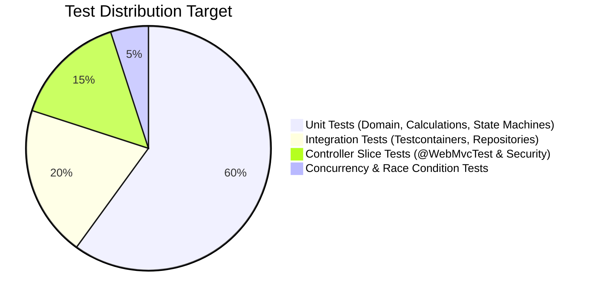
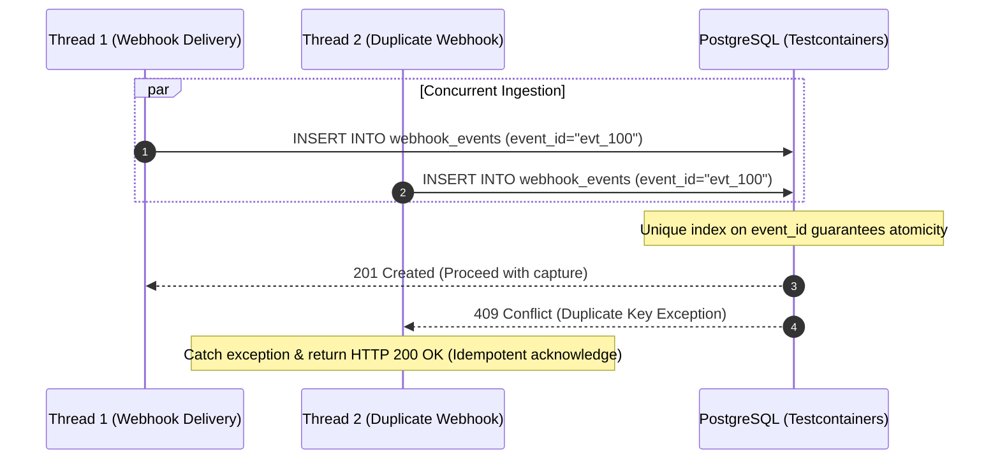

# Subscribly — Engineering Test Strategy & Verification Plan

**Document Version:** 1.0.0  
**Status:** Approved Testing Standard  
**Author:** Principal SRE & Quality Engineer  

---

## 1. Testing Philosophy & Quality Principles

In high-concurrency financial and subscription systems, automated testing is the only credible defense against data corruption, duplicate billing, and security regressions.

### The Subscribly Standard:
1. **Zero Flakiness:** Tests must be completely deterministic. No `Thread.sleep()` without condition polling (use Awaitility).
2. **Real Database Integration:** No in-memory H2 shortcuts for persistence tests. All integration tests execute against a real **PostgreSQL container via Testcontainers** to validate dialect-specific SQL, Flyway migrations, and locking semantics.
3. **Financial Precision Rigor:** Every monetary calculation (proration, billing cycle adjustments, discounts) must be covered with edge cases down to the exact decimal cent (`scale = 2`).
4. **Concurrency by Design:** Race conditions in webhook delivery and subscription renewal must be explicitly provoked and proven safe in automated multi-threaded test suites.

---

## 2. The Testing Pyramid



---

## 3. Test Layers & Specifications

### 3.1 Layer 1: Unit Testing (Fast, In-Memory)
- **Scope:** Domain models, state machines, proration math, utility classes.
- **Frameworks:** JUnit 5, AssertJ, Mockito.
- **Coverage Target:** >85% branch coverage on domain and billing logic.

#### Key Test Scenarios:
| Component | Test Class | Core Verification |
|---|---|---|
| **Subscription State** | `SubscriptionStateMachineTest` | Valid transitions (`ACTIVE` → `PAST_DUE`), blocks invalid jumps (`CANCELLED` → `ACTIVE`). |
| **Payment State** | `PaymentStateMachineTest` | Valid transitions (`PENDING` → `AUTHORIZED` → `CAPTURED`), disallows transitions from terminal states. |
| **Proration Calculator** | `ProrationServiceTest` | Calculates precise `BigDecimal` refund/credit when upgrading mid-cycle with exact cents. |
| **Retry Backoff** | `BackoffCalculatorTest` | Verifies exponential intervals: `15m` (retry 1), `30m` (retry 2), `60m` (retry 3). |
| **JWT Utility** | `JwtUtilTest` | Validates token creation, claim extraction, role authorities, and expired signature rejection. |

---

### 3.2 Layer 2: Web Layer Slice Testing (`@WebMvcTest`)
- **Scope:** REST controllers, request serialization, validation annotations (`@Valid`), error status codes.
- **Frameworks:** Spring MockMvc, Spring Security Test.

#### Key Test Scenarios:
| Controller | Test Focus | Expected Result |
|---|---|---|
| `AuthController` | Invalid registration payload (blank email, short password) | HTTP 400 Bad Request with field validation errors in RFC 7807 format. |
| `SubscriptionController` | Access `/api/v1/subscriptions/my` without JWT | HTTP 401 Unauthorized. |
| `AdminUserController` | Regular subscriber token attempting admin route | HTTP 403 Forbidden. |
| `PaymentController` | Malformed payment order request | HTTP 400 Bad Request. |

---

### 3.3 Layer 3: Integration Testing (Real PostgreSQL with Testcontainers)
- **Scope:** Full Spring Boot context, Flyway migration scripts, Spring Data JPA queries, transaction boundaries.
- **Frameworks:** `@SpringBootTest(webEnvironment = RANDOM_PORT)`, Testcontainers (`org.testcontainers:postgresql`).

#### Key Test Scenarios:
| Test Class | Focus | Verification |
|---|---|---|
| `FlywayMigrationIntegrationTest` | Clean DB migration from `V1` | Migrates successfully without syntax or index errors on PostgreSQL 15+. |
| `SubscriptionRepositoryTest` | Querying due subscriptions | Finds all subscriptions with `status = ACTIVE` and `endDate <= today`. |
| `PaymentAuditIntegrationTest` | Payment audit trail persistence | Verifies `PaymentAuditLog` writes in separate transaction (`REQUIRES_NEW`) even if payment fails. |
| `WebhookDeduplicationTest` | Webhook ingestion idempotency | Second webhook with duplicate `event_id` is caught by unique constraint and rejected gracefully. |

---

### 3.4 Layer 4: Concurrency & Race Condition Testing
- **Scope:** Multi-threaded stress testing for critical financial flows.
- **Frameworks:** Java `ExecutorService`, `CountDownLatch`, `CyclicBarrier`, Awaitility.

#### Critical Concurrency Tests:


1. **Concurrent Renewal Sweep:** 5 concurrent threads attempting to execute the renewal batch for the same due subscriptions. **Verification:** Exactly one renewal payment is generated per subscription; zero duplicate charges.
2. **Optimistic Locking Race:** 2 threads attempting to update subscription status simultaneously. **Verification:** First commit succeeds; second thread throws `OptimisticLockingFailureException`.

---

## 4. Test Execution & Verification Commands

```bash
# 1. Run fast unit test suite (<10s)
.\mvnw.cmd test -Dtest="*Test" -Dexclude="*IntegrationTest"

# 2. Run full test suite including Testcontainers (requires Docker)
.\mvnw.cmd verify

# 3. Generate JaCoCo code coverage report
.\mvnw.cmd jacoco:report
# View report: target/site/jacoco/index.html
```

---

## 5. Continuous Integration (CI) Enforcement

The GitHub Actions workflow (`.github/workflows/ci.yml`) enforces the following gates:
1. **Compilation Check:** Code compiles cleanly under JDK 21.
2. **Unit & Slice Tests:** All unit and WebMvc tests must pass.
3. **Integration Tests:** Testcontainers spins up a real PostgreSQL service container in CI.
4. **Code Quality Gate:** Zero compilation warnings, no disabled tests (`@Disabled` disallowed in PRs).
